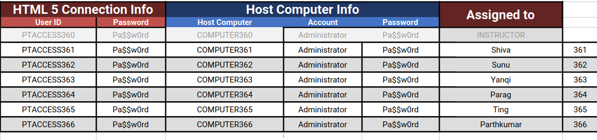

# VMs

This directory contains all the info you need to log in to the provided VMs.

These VMs will be available continuously until the end of the second day of class on Oct 27

There are several documents in the repo provided by Protech on how to use the VMs

There is also a table provided as VMs.png that shows you what machine you have been assigned,

The lab URS is [Protech VMs](https://labs.protechtraining.com/#/)

### Cutting and Pasting

The ability to cut and past between your host computer and your VM has been disabled for security reasons.

If you want to cut and paste the lab code into your editor in the VM, clone the lab repository into the VM and then do all the cutting/pasting within the VM.

